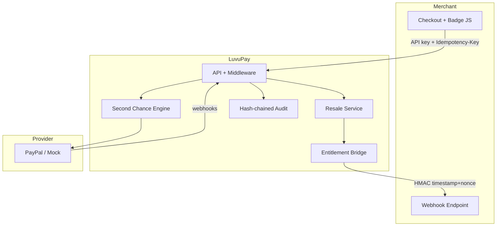

# LuvuPay API

**Ethical subscription management & resale infrastructure for B2B merchants.**

> Prevent subscription traps. Enable a circular economy for unused access. Never take custody of the merchant’s user database.


---

## Why LuvuPay?

Recurring billing is powerful — and easy to abuse by accident. Customers forget to cancel; merchants keep the charge; trust erodes.

LuvuPay sits between the payment provider and the merchant to:

1. **Second Chance (48h)** — intercept a forgotten renewal, offer a fair split (user / charity / merchant), auto-cancel.
2. **Resale Marketplace** — sell remaining days instead of wasting them.
3. **Zero-Trust Entitlement Bridge** — transfer access via signed webhooks; no shared DB.
4. **Adaptive Nudge** — pause serial forgetters 72h before billing.
5. **Invisible UX** — no end-user LuvuPay accounts; map `merchant_user_id` + email.

Built for international judges, auditors, and external developers — with Stripe-grade docs, idempotency, and hash-chained audit logs.

---

## Tech Stack

| Layer | Technology |
|-------|------------|
| Runtime | PHP 8.2+, Laravel 12 |
| Database | **PostgreSQL** (CI + Docker) · SQLite for quick local runs · MySQL/MariaDB works but is not covered by CI |
| Queue / Cache | `sync`/`file` locally · Redis + Horizon in production |
| Payments | Abstracted provider (Mock / PayPal) |
| Observability | JSON Monolog, `/api/v1/health`, Telescope (dev), Horizon (prod) |
| Dashboard | Blade · Tailwind · Chart.js · AG Grid |

---

## Quick Start

```bash
composer install
cp .env.example .env          # defaults: SQLite + mock payments, no credentials needed
php artisan key:generate
php artisan migrate:fresh --seed
php artisan serve
```

For PostgreSQL (what CI and `docker compose` use) set these in `.env` instead of `DB_CONNECTION=sqlite`:

```env
DB_CONNECTION=pgsql
DB_HOST=127.0.0.1
DB_PORT=5432
DB_DATABASE=luvupay
DB_USERNAME=luvupay
DB_PASSWORD=change-me
```

Local without Redis: `CACHE_STORE=file`, `QUEUE_CONNECTION=sync`, `SESSION_DRIVER=file`, `AUDIT_HMAC_KEY=<openssl rand -hex 32>`.

Seed prints a **one-time API key** (`lp_live_…`).

| URL | Purpose |
|-----|---------|
| http://localhost:8000/ | Landing |
| http://localhost:8000/dashboard | Merchant console |
| http://localhost:8000/onboarding | Onboarding wizard |
| http://localhost:8000/settings | API keys & exports |
| http://localhost:8000/analytics | Charts |
| http://localhost:8000/docs | Developer docs |
| http://localhost:8000/up (liveness) · /internal/health (token) | Health check |

Optional queue worker (when not `sync`):

```bash
php artisan queue:work
php artisan schedule:work
```

---

## Architecture (Mermaid)



---

## Documentation site (in-app)

- [/docs](http://localhost:8000/docs) — index  
- [/docs/api](http://localhost:8000/docs/api) — OpenAPI-style reference  
- [/docs/webhooks](http://localhost:8000/docs/webhooks) — Entitlement Bridge + PHP/Node verify snippets  
- [/docs/postman](http://localhost:8000/docs/postman) — collection layout + pre-request scripts  
- File: `postman/LuvuPay.postman_collection.json`

## Observability

See `docs/OBSERVABILITY.md` — JSON logs, Telescope, Horizon, health checks.

---


**Ethical subscription management & resale infrastructure for B2B merchants.**

LuvuPay prevents “subscription traps” (users forgetting to cancel), enables a circular economy for unused subscription time, and never stores the merchant’s user database or master keys.

Built with **Laravel 12 · PHP 8.2+ · PostgreSQL / SQLite** · abstracted payment provider (PayPal / Mock).

---

## Table of Contents

1. [Business Features](#1-business-features)
2. [Architecture Overview](#2-architecture-overview)
3. [Tech Stack](#3-tech-stack)
4. [Project Structure](#4-project-structure)
5. [Quick Start](#5-quick-start)
6. [Configuration](#6-configuration)
7. [Domain Models & Database](#7-domain-models--database)
8. [Payment Abstraction](#8-payment-abstraction)
9. [The Luvi Engine (Second Chance)](#9-the-luvi-engine-second-chance)
10. [Resale Marketplace & Entitlement Bridge](#10-resale-marketplace--entitlement-bridge)
11. [Adaptive Nudge](#11-adaptive-nudge)
12. [Security Layer](#12-security-layer)
13. [HTTP API & Routes](#13-http-api--routes)
14. [Jobs & Scheduler](#14-jobs--scheduler)
15. [Merchant Dashboard](#15-merchant-dashboard)
16. [Seamless Integration (Badge / Snippet)](#16-seamless-integration-badge--snippet)
17. [Local Development Notes](#17-local-development-notes)
18. [Glossary](#18-glossary)

---

## 1. Business Features

### 1.1 The Luvi Engine (Second Chance)

When a recurring charge is captured (e.g. user forgot to cancel):

1. LuvuPay puts the charge in **HELD** state for **48 hours**.
2. User receives a signed-link email → “Use Second Chance”.
3. If triggered:
   - Subscription is **auto-cancelled**.
   - Funds are split (defaults, basis points):
     - **30%** refunded to the user
     - **20%** donated to charity (PayPal Payout)
     - **50%** retained by the merchant
4. If the window expires with no action → charge is **SETTLED** (merchant keeps 100%).

### 1.2 Resale Marketplace

Instead of only refunding, User A can sell remaining access (e.g. 29 days) to User B:

1. User A creates a **listing**.
2. User B checks out (PayPal order).
3. On capture: seller is paid, listing marked sold.
4. **Entitlement Bridge** tells the merchant (via signed webhook) to revoke A and grant B — **LuvuPay never holds merchant DB or keys**.

### 1.3 Entitlement Bridge (Zero-Trust)

Outbound HMAC-SHA256 webhooks to the merchant:

- Headers: `X-LuvuPay-Timestamp`, `X-LuvuPay-Nonce`, `X-LuvuPay-Signature`
- Replay protection: reject if timestamp > 5 minutes old; nonce single-use
- Merchant acknowledges via `POST /api/v1/entitlements/ack`

### 1.4 Adaptive Nudge (Anti-Loop)

If a user is a “serial forgetter” (forgotten cancel count ≥ threshold, default **2**):

- **72 hours** before next billing, auto-charge is **paused**.
- User gets a confirmation email (signed URL).
- Confirm → resume; do nothing → no charge.

### 1.5 Seamless Integration

- End-users **never** create a LuvuPay account.
- Identity = `merchant_user_id` + `email` mapped by the merchant.
- One-line JS badge: “Protected by LuvuPay” injected into merchant checkout.

---

## 2. Architecture Overview

```
                    ┌─────────────────────────────────────┐
                    │           Merchant App              │
                    │  (checkout badge + webhook endpoint)│
                    └──────────────┬──────────────────────┘
                                   │ API key / signed webhooks
                    ┌──────────────▼──────────────────────┐
                    │            LuvuPay API              │
                    │  Middleware → Controllers → Services│
                    │  Jobs / Scheduler / Audit chain     │
                    └──────────────┬──────────────────────┘
                                   │ PaymentProviderInterface
                    ┌──────────────▼──────────────────────┐
                    │     Mock  |  PayPal (Subscriptions, │
                    │           Refunds, Payouts, Orders) │
                    └─────────────────────────────────────┘
```

**Principles**

- **No native end-user auth** — only merchant API keys + signed public links.
- **Idempotent money movement** — every financial POST requires `Idempotency-Key`.
- **Append-only audit** — hash-chained `audit_logs` (HMAC).
- **Provider-agnostic** — swap PayPal ↔ Mock via config/interface.

---

## 3. Tech Stack

| Layer | Choice |
|--------|--------|
| Framework | Laravel 12 (PHP 8.2+) |
| Database | PostgreSQL (primary) · SQLite (local) · MySQL/MariaDB (works, not in CI) |
| ORM | Eloquent |
| Queue | `sync` (local) or Redis/database |
| Cache | `file` (local) or Redis |
| Payments | `PaymentProviderInterface` → Mock / PayPal |
| Frontend (dashboard) | Blade + Tailwind CDN + AG Grid + Alpine |

---

## 4. Project Structure

```
app/
├── Console/Commands/          # Scheduler commands (nudge, settle, resale, audit)
├── Contracts/Payment/         # Payment provider interfaces
├── DTOs/Payment/              # Immutable payment result objects
├── Enums/                     # SubscriptionStatus, TransactionType, …
├── Events/PayPal/             # Domain events from provider webhooks
├── Exceptions/                # LuvuApiException hierarchy
├── Http/
│   ├── Controllers/           # API + public signed pages + dashboard
│   └── Middleware/            # Auth, idempotency, audit context, signatures
├── Jobs/                      # Delayed / async work (48h, entitlement, etc.)
├── Listeners/                 # React to PaymentCaptured, payout outcomes, …
├── Models/                    # Merchant, Subscription, Transaction, …
├── Observers/                 # AuditObserver (model → audit_logs)
├── Providers/                 # Luvi, Payment, Security, App
├── Services/
│   ├── Luvi/                  # SecondChanceService, LedgerService
│   ├── Resale/                # ResaleService, EntitlementBridge
│   ├── Payment/               # Mock + PayPal implementations
│   ├── PayPal/                # Low-level client & webhook parser
│   └── Security/              # AuditLogger, WebhookSigner, UrlGuard
├── Support/                   # Money, AuditContext, HtmlPage
└── Traits/Auditable.php       # Auto-observe models into audit chain

config/luvupay.php             # Split BPS, windows, webhook/idempotency settings
database/migrations/           # Core tables (SQLite/PostgreSQL tested in CI)
routes/
├── luvupay-api.php            # Merchant API
├── paypal.php                 # Provider webhooks
├── luvupay-public.php         # Signed Second Chance / Nudge pages
├── dashboard.php              # Merchant console
└── web.php / console.php
resources/views/dashboard/     # Merchant UI
```

---

## 5. Quick Start

### Requirements

- PHP 8.2+, Composer. Database: nothing to install for SQLite; PostgreSQL 15+ for anything shared
- Node optional (Vite not required for basic dashboard)

### Setup

```bash
composer install

cp .env.example .env     # SQLite + mock payments by default

# optional: PostgreSQL instead of SQLite
# DB_CONNECTION=pgsql  DB_HOST=127.0.0.1  DB_PORT=5432  DB_DATABASE=luvupay  DB_USERNAME=luvupay  DB_PASSWORD=...

CACHE_STORE=file
QUEUE_CONNECTION=sync
SESSION_DRIVER=file

LUVUPAY_PAYMENT_DRIVER=mock
AUDIT_HMAC_KEY=some-long-random-string-at-least-32-chars

php artisan key:generate   # if APP_KEY empty
php artisan migrate:fresh --seed
php artisan serve
```

Seed output prints a **one-time demo API key** (`lp_live_...`). Save it.

### Optional Vite

```bash
npm install
npm run dev
```

Dashboard works without Vite (CDN assets).

---

## 6. Configuration

### `config/luvupay.php`

| Key | Meaning |
|-----|---------|
| `payment.driver` | `mock` or `paypal` |
| `defaults.split_*_bps` | 3000 / 2000 / 5000 (user / charity / merchant) |
| `defaults.second_chance_window_hours` | 48 |
| `defaults.nudge_lead_hours` | 72 |
| `defaults.serial_forgetter_threshold` | 2 |
| `second_chance.on_first_charge` | false = first charge is not “forgot to cancel” |
| `resale.*` | seller split, min price, reservation minutes |
| `webhooks.timestamp_tolerance_seconds` | 300 (5 min) |
| `idempotency.ttl_seconds` | how long responses are cached |
| `audit.key` | HMAC key for audit chain (`AUDIT_HMAC_KEY`) |

Merchant rows can override split BPS and thresholds per merchant.

### Payment driver

```env
LUVUPAY_PAYMENT_DRIVER=mock     # default for local
# LUVUPAY_PAYMENT_DRIVER=paypal
# PAYPAL_CLIENT_ID=...
# PAYPAL_CLIENT_SECRET=...
# PAYPAL_WEBHOOK_ID=...
```

---

## 7. Domain Models & Database

| Table | Role |
|-------|------|
| `merchants` | API key (hash only), publishable key, split BPS, thresholds |
| `subscriptions` | `merchant_user_id` + email, provider ids, status, nudge fields |
| `transactions` | Ledger: charge / refund / charity_payout / merchant_retention / resale_* |
| `resale_listings` | Marketplace listings + entitlement status |
| `charity_wallets` | Platform charity payout destinations |
| `webhook_endpoints` | Merchant callback URLs + encrypted secrets |
| `audit_logs` | Append-only hash chain (uuid, prev_hash, hash, actor, …) |

**Money** is always **integer minor units** (`amount_minor`) + `currency` — never floats (`App\Support\Money`).

**Enums**

- `SubscriptionStatus`: pending_approval, active, paused_by_nudge, suspended, resold, cancelled, expired  
- `TransactionType`: charge, refund, charity_payout, merchant_retention, resale_payout, resale_capture  
- `TransactionStatus`: pending, held, processing, completed, settled, failed, cancelled  
- `ListingStatus` / `EntitlementStatus`: active → reserved → sold, pending → sent → acknowledged, …

Models using `Auditable` trait are observed by `AuditObserver` → every create/update/delete writes to `audit_logs`.

---

## 8. Payment Abstraction

### Interfaces (`app/Contracts/Payment/`)

- `PaymentProviderInterface` — aggregates all capabilities  
- `SubscriptionGatewayInterface` — create / get / suspend / activate / cancel  
- `OrderGatewayInterface` — one-off orders (resale checkout)  
- `RefundGatewayInterface` — refund capture  
- `PayoutGatewayInterface` — send payout (charity / seller)  
- `ProviderWebhookInterface` — parse & verify provider webhooks  

### Implementations

- `MockPaymentProvider` — deterministic, cache-backed, no network  
- `PayPalPaymentProvider` + `PayPalClient` — real API  

Bound in `PaymentServiceProvider` based on `luvupay.payment.driver`.

### DTOs

`ProviderSubscription`, `OrderResult`, `CaptureResult`, `RefundResult`, `PayoutRequest`, `PayoutResult`, `ProviderWebhookEvent`.

---

## 9. The Luvi Engine (Second Chance)

**Service:** `App\Services\Luvu\SecondChanceService`

```
charge captured
    → registerCharge() → status HELD + second_chance_expires_at (+48h)
    → dispatch ExpireSecondChanceJob (delay)
    → email signed link

User clicks "Second Chance"
    → trigger()  (row lock)
    → child txs: Refund, CharityPayout, MerchantRetention (idempotency keys sc:{id}:{type})
    → status PROCESSING
    → ExecuteSecondChanceSplitJob
        → cancel subscription
        → provider refund + payout
        → COMPLETED

Window expires / sweeper
    → settleIfExpired() → SETTLED (merchant keeps 100%)
```

**Safety**

- Trigger vs settle use locking so both cannot win.  
- Child ledger rows use deterministic idempotency keys reused as provider request ids.  
- Split uses largest-remainder so parts always sum to the charge.

**Controllers**

- API: `POST /api/v1/transactions/{id}/second-chance` (merchant + idempotent)  
- Public: signed `GET/POST /second-chance/{transaction}` (`HtmlPage`, no account)

**Listener:** `OpenSecondChanceForCharge` on `PaymentCaptured`.

---

## 10. Resale Marketplace & Entitlement Bridge

**Service:** `App\Services\Resale\ResaleService`

Flow: **list → checkout (reserve + order) → complete (capture, pay seller, transfer access)**.

**EntitlementBridge** (`app/Services/Resale/EntitlementBridge.php`)

- Builds deterministic payload (`entitlement.transfer`).  
- Signs with `WebhookSigner` (timestamp + nonce + HMAC).  
- Delivered by `DeliverEntitlementTransferJob`.  
- Merchant ACKs: `POST /api/v1/entitlements/ack`.

LuvuPay **does not** open the merchant’s DB; it only instructs the merchant securely.

---

### 10.0 Console UI & Merchant Project Context

- Every console page extends `layouts/console` and is built from Blade components in `resources/views/components/ui/*`
  (`<x-ui.button>`, `card`, `stat`, `modal`, `slide-over`, `table`, `input`, `badge`, `alert`, `project-bar`, …). Public pages use `layouts/public`.
- The dashboard operates on one **project** (`App\Support\MerchantProject`, configured by `DEMO_PROJECT_*`): header bar, checkout
  modal, missed-cancellation simulator, and the grid's "Product / Plan" column all derive from it. The browser never chooses the plan or price.
- Assets are self-hosted (no CDN): Alpine, AG Grid (`public/vendor`), and `public/css/ui.css`. Rebuild CSS after changing templates:
  `npm run build:ui`. Pages ship a strict CSP `<meta>`; only the dashboard relaxes `style-src` (AG Grid sets inline styles).
- `welcome`, `login`, `register` (and the MFA/verify/invite pages) intentionally keep their original layout and `public/css/app.css`.

### 10.1 Public B2C marketplace (`/marketplace`)

Separate from the merchant resale API above; backed by `marketplace_listings` and `MarketplaceService`.

- **Sell**: `POST /api/marketplace/sell` (CSRF-protected, 10/min). With `MARKETPLACE_REQUIRE_SELLER_VERIFICATION=true`
  (default in production) the listing is `pending` until the seller opens the signed link emailed to them.
- **Buy**: `POST /api/marketplace/listings/{id}/buy` atomically reserves the listing for `MARKETPLACE_RESERVATION_MINUTES`,
  then creates a PayPal order. Provider failure or an abandoned checkout returns the listing to the pool (`resale:maintain` + lazy release).
- **Return/cancel URLs** carry a per-reservation token; only the matching token can capture or cancel.
- **Settlement**: capture must be `COMPLETED` for the exact price, then the sale is marked `sold` and posted to the ledger
  (`marketplace:{id}`: clearing debit; seller payable + platform fee credits) exactly once.
- Public responses never include seller/buyer emails (the seller is shown masked).

## 11. Adaptive Nudge

**Command:** `luvi:nudge-scan` (hourly schedule)

Finds subscriptions where:

- `next_billing_at` within ~72h  
- user’s forgotten-cancel count ≥ merchant threshold  

Then:

- Suspends provider subscription  
- Sets status `paused_by_nudge`  
- Emails signed confirmation link  

**Public pages:** `/nudge/{subscription}` (show + confirm) via `NudgeController`.

**Job:** `ApplyAdaptiveNudgeJob` for async work if needed.

---

## 12. Security Layer

### Merchant authentication

`AuthenticateMerchant` middleware:

- Bearer / `X-LuvuPay-Key`  
- Lookup by `hash('sha256', key)` → `merchants.api_key_hash`  
- Only hash stored; raw key shown once at issue time  

### Idempotency

`EnsureIdempotency` middleware:

- Header `Idempotency-Key` required on mutating financial routes  
- First request: claim key → run → store response  
- Replay same key + body → cached response (`Idempotent-Replayed: true`)  
- Same key + different body → 422  
- Concurrent same key → 409 + Retry-After  

### Webhook signing

`WebhookSigner`:

```
Signed string = "v1\n{timestamp}\n{nonce}\n{raw body}"
Signature     = HMAC-SHA256(secret, signed string)
```

Headers: `X-LuvuPay-Timestamp`, `X-LuvuPay-Nonce`, `X-LuvuPay-Signature`  
Reject if timestamp outside tolerance or nonce reused.

### Audit chain

`AuditLogger` + `AuditObserver`:

- Each event: `prev_hash` + canonical JSON → HMAC → `hash`  
- Per-merchant chain (null merchant_id = system chain)  
- `audit:verify` command recomputes and detects tampering  

### Other

- `UrlGuard` — blocks unsafe entitlement webhook targets in production  
- `CaptureAuditContext` — request id, IP, UA, actor on every API request  
- Public end-user pages authenticated **only** by Laravel signed URLs  

---

## 13. HTTP API & Routes

Registered in `bootstrap/app.php` (`then:` callback).

### Merchant API (`routes/luvupay-api.php`) — prefix `/api`

| Method | Path | Middleware | Purpose |
|--------|------|------------|---------|
| GET | `/v1/badge.js` | throttle | Public badge script |
| GET | `/v1/snippet` | merchant.auth | Embed snippet for merchant |
| POST | `/v1/subscriptions` | merchant.auth, idempotent | Create subscription |
| POST | `/v1/transactions/{id}/second-chance` | merchant.auth, idempotent | Trigger Second Chance |
| GET/POST/DELETE | `/v1/resale-listings…` | merchant.auth (+ idempotent on writes) | Marketplace |
| POST | `/v1/entitlements/ack` | merchant.auth + signature | Merchant ACK |

Auth: `Authorization: Bearer lp_live_...`

### PayPal webhooks (`routes/paypal.php`)

`POST /api/v1/webhooks/paypal` — outside merchant auth; verified by provider signature.

### Public signed pages (`routes/luvupay-public.php`)

| Path | Purpose |
|------|---------|
| `/second-chance/{transaction}` | User Second Chance UI |
| `/nudge/{subscription}` | Adaptive Nudge confirm UI |

### Dashboard (`routes/dashboard.php`)

| Path | Purpose |
|------|---------|
| `/dashboard` | Merchant console page |
| `/api/v1/dashboard/summary` | KPI JSON |
| `/api/v1/dashboard/transactions` | Ledger grid |
| `/api/v1/dashboard/resale-listings` | Listings grid |
| `/api/v1/dashboard/audit-logs` | Audit trail |

---

## 14. Jobs & Scheduler

### Jobs (`app/Jobs/`)

| Job | Role |
|-----|------|
| `ExpireSecondChanceJob` | Delayed 48h: settle if still HELD |
| `ExecuteSecondChanceSplitJob` | Refund + charity payout + complete |
| `DeliverEntitlementTransferJob` | Signed webhook to merchant |
| `SettleResaleSaleJob` | Finalize resale money movement |
| `ApplyAdaptiveNudgeJob` | Pause + notify serial forgetters |

### Commands (`routes/console.php` schedule)

| Command | Schedule | Role |
|---------|----------|------|
| `luvi:nudge-scan` | hourly | Adaptive Nudge scan |
| `luvi:settle-expired` | every 5 min | Safety net for Second Chance timers |
| `resale:maintain` | every minute | Release reservations / expire listings |
| `audit:verify` | daily 02:30 | Hash-chain integrity check |

Local:

```bash
php artisan schedule:work
# or with QUEUE_CONNECTION=database/redis:
php artisan queue:work
```

With `QUEUE_CONNECTION=sync`, jobs run inline (no worker needed).

---

## 15. Merchant Dashboard

- View: `resources/views/dashboard/index.blade.php`  
- Stack: Tailwind (CDN), AG Grid, Alpine.js  
- Data: same-origin JSON under `/api/v1/dashboard/*`  
- Shows: volume, Second Chance stats, active listings, serial forgetters, transactions, audit logs  

Open: **http://localhost:8000/dashboard**

---

## 16. Seamless Integration (Badge / Snippet)

**Controller:** `SnippetController`

- `GET /api/v1/badge.js` — cacheable public script  
- `GET /api/v1/snippet` (authenticated) — one-line embed instructions for the merchant  

End-users never register with LuvuPay; the merchant passes `merchant_user_id` + email on API calls.

---

## 17. Local Development Notes

### Databases

- **PostgreSQL** is the reference database: CI runs the full suite on it, and it is the only driver where the
  ledger and audit tables are *also* protected by database triggers (`UPDATE`/`DELETE` raise) plus `CHECK` constraints.
- **SQLite** is for quick local runs and unit tests. Immutability there is enforced only by the Eloquent models.
- **MySQL/MariaDB** should work (no `jsonb`, no pgsql-only DDL outside `getDriverName() === 'pgsql'` guards) but is not
  exercised in CI, and, like SQLite, has no database-level append-only protection. Do not run real money on it
  without adding equivalent triggers or revoking `UPDATE`/`DELETE` on the `ledger_*` and `audit_logs` tables.

### Without Redis

```env
CACHE_STORE=file
QUEUE_CONNECTION=sync
SESSION_DRIVER=file
```

Avoids `Predis` connection errors when Redis is not installed.

### Mock payments

```env
LUVUPAY_PAYMENT_DRIVER=mock
```

No real money movement; ideal for UI and flow testing.

### Common commands

```bash
php artisan migrate:fresh --seed
php artisan serve
php artisan config:clear
php artisan route:list
php artisan schedule:work
```

---

## 18. Glossary

| Term | Meaning |
|------|---------|
| **Second Chance** | 48h window after a forgotten charge to split & cancel |
| **HELD / SETTLED / PROCESSING** | Transaction statuses for the Luvi Engine |
| **Entitlement Bridge** | Zero-trust signed webhook to transfer access A→B |
| **Adaptive Nudge** | Proactive pause 72h before bill for serial forgetters |
| **BPS** | Basis points (10000 = 100%) |
| **amount_minor** | Integer cents (or equivalent); never float |
| **merchant_user_id** | Merchant’s own user id (LuvuPay has no end-user accounts) |
| **Idempotency-Key** | Client-generated key so retries never double-charge |

---

## License / Status

Internal / product development codebase for LuvuPay ethical subscription infrastructure.

For questions on a specific file, start from the service layer (`SecondChanceService`, `ResaleService`, `EntitlementBridge`, `AuditLogger`) — controllers stay thin; business rules live in services and jobs.

---

## What changed in this hardening release
See `MATURITY.md` (controls), `docs/RUNBOOK.md` (operations), `docs/adr/` (decisions) and `openapi.yaml` (API).
Quick start: `cp .env.example .env && php artisan key:generate && php artisan migrate --seed && npm install && npm run build:css`.
Production-shaped stack: `docker compose up -d --build` (Postgres, Redis, worker, scheduler, Mailpit at :8025).
