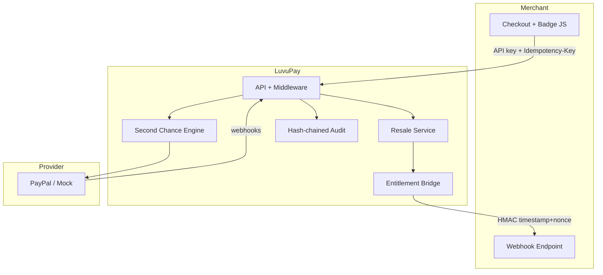

# LuvuPay: AI Smart-Convert for forgotten subscriptions

**A subscriber forgot to cancel. Instead of a chargeback or a full refund, an AI model proposes how the unused value is settled, guardrails and the merchant decide, PayPal Payouts pays, and every step leaves a public audit trail.**

Built for the [PayPal AI Hackathon](https://paypalaihackathon.devpost.com/). Everything runs on the **PayPal Sandbox** (test money only).

| | |
|---|---|
| Live demo | https://luvupay.luvryon.com |
| Demo video (under 3 min) | https://youtu.be/8i4vntV_c-A |
| Devpost | https://devpost.com/software/luvupay-ai-powered-revenue-recovery-dispute-defense |
| Test account | see the *Notes for judges* on the Devpost page (local seed: `owner@demomerchant.test` / `SecurePass1`) |
| Full technical reference | [docs/REFERENCE.md](docs/REFERENCE.md) |


---

## The one story: AI proposes, rules decide, PayPal pays, everything is auditable

A subscriber forgot to cancel. A refund means a chargeback fee and a lost customer. LuvuPay **Smart-Convert** handles it in six visible steps:

```
1 Subscriber forgot ─► 2 AI proposes ─► 3 Guardrails / you decide ─► 4 PayPal Payouts pays ─► 5 Donation ─► 6 Audit trail
```

| Step | What happens | Where you see it |
|---|---|---|
| 2 · AI proposes | NVIDIA Nemotron (Nebius) splits the unused value into **store credit / charity / fee** and states why | result card, `ai.rationale` |
| 3 · Guardrails / you decide | Deterministic policy caps fee and charity share. In approval mode the merchant approves, **lowers the donation**, or rejects. The model never touches money | `split.model_raw` vs final split, `guardrail_adjustments` |
| 4 · PayPal pays | PayPal Payouts (sandbox) executes the charity share; the batch is read back from PayPal | `paypal.payout_batch_id` |
| 5 · Donation | A visible stage with amount, share of the unused value, receipt id and status | donation card, `donation` block |
| 6 · Audit trail | Public read-only evidence page + JSON, ledger rows, webhook event | `/evidence/smart-convert/{run}` |

> **The donation is an example.** The recipient is shown as *Example Charity (sandbox)* with an **EXAMPLE · SANDBOX** tag on every surface, and PayPal Sandbox moves test money only. No real organisation is named or paid. Change the label with `SMART_CONVERT_CHARITY_LABEL`; set `SMART_CONVERT_CHARITY_EXAMPLE=false` only when you really configured a recipient.

### What the AI does, and what it does not

| The model (NVIDIA Nemotron on Nebius) | The code and the humans |
|---|---|
| Receives only: unused days, unused value, currency, inactive days, a hashed email and the policy limits (max fee, max charity share) | Validates the answer, **caps the fee and the charity share**, makes the three amounts sum exactly to the unused value, and records every change in `guardrail_adjustments` |
| Proposes a split into store credit / charity / fee, a risk score and 2-4 short reasons specific to this case | In approval mode the merchant approves, **lowers** the donation (never raises it) or rejects |
| Writes the stage reminders of the Journey (7d, 3d, 48h, 6h, +1 day) | PayPal Payouts executes. The model never touches money |

**Why a model and not a fixed formula?** A fixed split ignores the case. The model sees how long the value went unused and how long the subscriber was inactive, and has to justify its split for that case in plain language. That justification is stored next to the untouched raw answer (`split.model_raw`), so a merchant or auditor can compare what the AI proposed with what was finally paid. If the model is unreachable the run fails in strict mode, or in fallback mode uses a fixed 50/33/17 split that is **labelled FALLBACK** on the evidence page, so a non-AI result is never passed off as AI.

**Run it in two minutes** (needs `LUVUPAY_DEMO_SIMULATOR=true`, `NEBIUS_API_KEY`, and for real payouts `LUVUPAY_PAYMENT_DRIVER=paypal` + sandbox credentials; see [DEMO.md](DEMO.md)):

1. Sign in at `/dashboard` (`owner@demomerchant.test` / `SecurePass1` after seeding) and connect PayPal in **Settings** (OAuth, or the sandbox demo connect).
2. Open **Missed cancellation journey**, pick a subscriber and move the timeline to **1 day after expiry**. Smart-Convert is a recovery option of the Journey: it stays locked until that stage, and the server enforces it (HTTP 422 otherwise).
3. Click **Check readiness (live AI ping)**, optionally tick **Require my approval**, then **Run AI Smart-Convert Protocol**. The unused value comes from the renewal being recovered.
4. In approval mode, lower the donation and **Approve**. Then open the **AI Negotiation Evidence** page.

**Test it for real in Postman** (no code): import `postman/LuvuPay.postman_collection.json` plus one environment: `LuvuPay.postman_environment.json` (hosted, `https://luvupay.luvryon.com`) or `LuvuPay.local.postman_environment.json` (`http://localhost:8000`). Select it and **Run collection**.

Folder 1 walks the story with assertions: it picks paid charges from the ledger (4a), starts the Missed Cancellation Journey for a renewal and moves it to *+1 day after expiry* (4b, because Smart-Convert is locked until that stage and the server enforces it), then runs Smart-Convert on that renewal and checks that the split adds up, the donation was lowered and never raised, a double approve is refused with 409, and the evidence matches the PayPal batch id. Folder 2 covers the API-key endpoints (idempotency, auth); folder 3 covers security checks. Set the variable `require_real=false` to run it against the mock driver. Details: [docs/POSTMAN.md](docs/POSTMAN.md).

> The ledger step needs at least three paid charges in the demo merchant. If it reports fewer, create some from the dashboard first (*Subscriber pays through PayPal*).

**Automated tests** run on PostgreSQL, the same engine as production, so the database triggers that make the ledger append-only are exercised too:

```bash
# once: a dedicated database (the suite wipes every table, never use your app database)
sudo -u postgres psql -c "CREATE USER luvu WITH PASSWORD 'luvu';"
sudo -u postgres psql -c "CREATE DATABASE luvupay_test OWNER luvu;"

php artisan test
```

`tests/bootstrap.php` refuses to start unless the database name ends in `_test` and `DB_URL` is empty, so a Neon URL in `.env` can never be wiped by accident. `.github/workflows/tests.yml` runs the same suite on every push using a PostgreSQL service container.

### Supporting features (not needed for the story above)

Second Chance (48h refund split), Resale Marketplace, Zero-Trust Entitlement Bridge, Adaptive Nudge, and an invisible-UX integration model (no end-user LuvuPay accounts; map `merchant_user_id` + email). They share the same ledger, audit chain and PayPal layer; see [docs/REFERENCE.md](docs/REFERENCE.md) (sections 1 and 9-11).

Built for judges, auditors and external developers: idempotency on every money request, a double-entry ledger, hash-chained audit logs, and AG Grid tables across the console.

---

## Tech Stack

| Layer | Technology |
|-------|------------|
| Runtime | PHP 8.2+, Laravel 12 · Laravel Octane on FrankenPHP (Docker) |
| Database | **PostgreSQL** (runtime and PHPUnit suite) · SQLite for quick local runs · MySQL/MariaDB should work but is not tested |
| Queue / Cache | `sync`/`file` locally · Redis + Horizon in production |
| Payments | Abstracted provider (Mock / PayPal Sandbox: Subscriptions, Payouts, OAuth connect) |
| AI | Nebius Token Factory · NVIDIA Nemotron (structured output, guardrails applied in code) |
| Observability | JSON Monolog, `/api/v1/health`, Telescope (dev), Horizon (prod) |
| Dashboard | Blade · Alpine.js · Tailwind CSS · Chart.js · AG Grid Enterprise (every table; set `AG_GRID_LICENSE_KEY`) |

---

## Quick Start

Two environment files ship with the repo:

| File | Use it for |
|---|---|
| `.env.local.example` | **Local run, no credentials:** SQLite (or local PostgreSQL), mock payments, no Redis |
| `.env.example` | **Production-shaped / deployed demo:** Neon PostgreSQL, Redis, SMTP, PayPal Sandbox, Nebius. It mirrors the environment the demo runs on, with placeholders instead of secrets |

### Local (no credentials)

```bash
composer install
cp .env.local.example .env
php artisan key:generate
php artisan migrate:fresh --seed
php artisan serve
```

For PostgreSQL (what `docker compose` and production use) set these in `.env` instead of `DB_CONNECTION=sqlite`:

```env
DB_CONNECTION=pgsql
DB_HOST=127.0.0.1
DB_PORT=5432
DB_DATABASE=luvupay
DB_USERNAME=luvupay
DB_PASSWORD=change-me
```

Local without Redis: `CACHE_STORE=file`, `QUEUE_CONNECTION=sync`, `SESSION_DRIVER=file`, `AUDIT_HMAC_KEY=<openssl rand -hex 32>`.

Seed prints a **one-time API key** (`lp_live_…`).

### Production-shaped / deployed demo

```bash
composer install --no-dev --optimize-autoloader
cp .env.example .env            # then replace every placeholder (reference below)
php artisan key:generate
php artisan migrate --force
php artisan db:seed --force     # demo merchant + one-time API key (needs LUVUPAY_ALLOW_DEMO_SEED=true)
php artisan config:clear
php artisan queue:work --queue=financial,webhooks,default   # separate process
```

The `Dockerfile` serves the app with Laravel Octane on FrankenPHP (`docker compose up -d --build` starts the full stack). After changing `.env`, run `php artisan config:clear` and restart Octane and the queue worker.

### Environment reference (`.env.example`)

| Group | Keys | Notes |
|---|---|---|
| App | `APP_ENV`, `APP_KEY`, `APP_DEBUG`, `APP_URL`, `TRUSTED_PROXIES` | `APP_DEBUG` must be `false` in production (the app refuses to boot otherwise). `APP_URL` must be the public https URL: receipts link to `/invoice/...` |
| Database | `DB_CONNECTION=pgsql`, `DATABASE_URL` | Neon works as is (`sslmode=require`). `DB_URL` is the same thing |
| Queue / cache / session | `CACHE_STORE`, `QUEUE_CONNECTION`, `SESSION_DRIVER`, `REDIS_*`, `SESSION_SECURE_COOKIE` | `REDIS_CLIENT=predis`. Use `sync`/`file` only locally |
| Mail | `MAIL_*` | Verification codes are sent synchronously; registration is rolled back if sending fails |
| Payments | `LUVUPAY_PAYMENT_DRIVER`, `PAYPAL_MODE`, `PAYPAL_CLIENT_ID`, `PAYPAL_SECRET`, `PAYPAL_WEBHOOK_ID`, `PAYPAL_SANDBOX_*`, `LUVUPAY_PAYOUT_SANDBOX_FALLBACK` | `mock` = no network. `paypal` is sandbox unless `PAYPAL_MODE=live` **and** `APP_ENV=production` |
| Payout receivers | `PAYPAL_MERCHANT_SANDBOX_EMAIL`, `PAYPAL_CHARITY_SANDBOX_EMAIL` | Use real PayPal **Sandbox** accounts, otherwise the donation is not visible on the PayPal side |
| Security | `AUDIT_HMAC_KEY`, `LUVUPAY_REQUIRE_MFA`, `LUVUPAY_API_RATE_LIMIT`, `LUVUPAY_ALLOW_INSECURE_WEBHOOK_TARGETS`, `METRICS_TOKEN` | `AUDIT_HMAC_KEY`: `openssl rand -hex 32`. An empty `METRICS_TOKEN` makes `/internal/metrics` return 404 |
| AI | `NEBIUS_API_KEY`, `NEBIUS_BASE_URL`, `NEBIUS_MODEL`, `NEBIUS_TIMEOUT`, `NEBIUS_CACHE_TTL`, `NEBIUS_ENABLED` | Model: `nvidia/NVIDIA-Nemotron-3-Nano-30B-A3B`. Without a key the app falls back to local templates, except Smart-Convert in strict mode |
| Demo | `DEMO_PROJECT_*`, `LUVUPAY_ALLOW_DEMO_SEED`, `LUVUPAY_DEMO_SIMULATOR`, `MARKETPLACE_RESERVATION_MINUTES`, `AG_GRID_LICENSE_KEY` | The plan and price are server-side; clients cannot override them. A trial AG Grid key shows a watermark and is for evaluation only |

Optional Smart-Convert, marketplace, payout-fee and session settings are listed, commented out, at the bottom of `.env.example`.

**Gotchas**

- Define every key **once**. Laravel's dotenv loader keeps the first value of a duplicated key, so a second `PAYPAL_MODE=sandbox` below a `PAYPAL_MODE=live` is silently ignored.
- The prefix is `LUVUPAY_`. A misspelled key such as `LUVIPAY_REQUIRE_MFA` is ignored without any error.
- With the `paypal` driver and empty credentials the app refuses to boot. Use `mock` for an offline run.
- `MAIL_ENCRYPTION` is not read by Laravel 12. Port 465 already uses implicit TLS, and `MAIL_SCHEME=smtps` makes it explicit.
- `NEBIUS_REQUIRED` is not read by the code. Smart-Convert strictness is `SMART_CONVERT_STRICT` (default `true`: an AI or PayPal failure fails loudly with HTTP 502).

| URL | Purpose |
|-----|---------|
| http://localhost:8000/ | Landing |
| http://localhost:8000/dashboard | Merchant console |
| http://localhost:8000/onboarding | Onboarding wizard |
| http://localhost:8000/settings | API keys & exports |
| http://localhost:8000/analytics | Charts |
| http://localhost:8000/docs | Developer docs |
| http://localhost:8000/up (liveness) · /internal/health (token) | Health check |

Optional queue worker (when not `sync`):

```bash
php artisan queue:work
php artisan schedule:work
```

---

## Architecture (Mermaid)



---

## Documentation site (in-app)

- [/docs](http://localhost:8000/docs) — index  
- [/docs/api](http://localhost:8000/docs/api) — OpenAPI-style reference  
- [/docs/webhooks](http://localhost:8000/docs/webhooks) — Entitlement Bridge + PHP/Node verify snippets  
- [/docs/postman](http://localhost:8000/docs/postman) — collection layout + pre-request scripts  
- File: `postman/LuvuPay.postman_collection.json`

## Observability

See `docs/OBSERVABILITY.md` — JSON logs, Telescope, Horizon, health checks.

---

Licensed under Apache-2.0. See [LICENSE](LICENSE).
